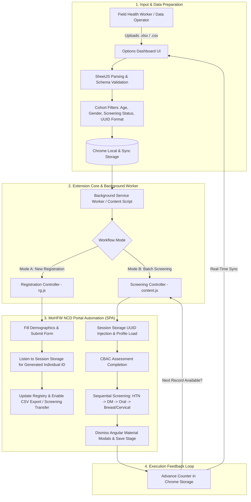

PROJECT 1: 🏥 Janani HBNC Auto-Pilot — Project Portfolio Case Study

> **A Client-Side Robotic Process Automation (RPA) Web Extension for the Ministry of Health and Family Welfare (MOHFW) Janani Portal**

---

## 📌 Executive Summary

**Janani HBNC Auto-Pilot** is a production-grade Chrome/Edge browser extension (Manifest V3) that automates the complex, multi-step entry of Home Based Newborn Care (**HBNC**), **New Born Care**, and **Sick Child Care** health records on the Indian Ministry of Health and Family Welfare (MOHFW) **Janani Portal** (`https://janani.mohfw.gov.in/`).

Engineered with a **zero-dependency client-side architecture**, the application parses healthcare spreadsheets (.xlsx, .xls, .csv) locally in the browser and drives a high-precision, 39-step synthetic automation engine through complex React Single-Page Application (SPA) components. It reduces per-record data entry time by over **90%**, eliminates human transposition errors, and ensures 100% compliance with healthcare privacy by keeping patient data entirely within the local browser runtime.

---

## 🎯 The Problem & Challenge

Frontline health workers, public health officials, and administrative staff manage high volumes of newborn follow-up records recorded in rural and semi-urban communities by ASHA (Accredited Social Health Activist) workers. 

### Key Pain Points:
1. **Tedious, Repetitive Multi-Step Workflow**: Every child entry requires a strict 39-step protocol involving multiple modal dialogs, search queries, cascading dropdowns, datepickers, and back-navigation across the portal.
2. **Complex State-Dependent Rules**: 
   - Row 1 (first visit) requires registering **New Born Care**, **Sick Child Care**, and **HBNC Visit 1**.
   - Subsequent rows (visits 2 through 7) require registering **HBNC ONLY**, strictly skipping one-time registration modules.
3. **High Risk of Transposition Errors**: Entering 10-digit mobile numbers, complex visit dates, and matching specific ASHA worker names from spreadsheet lists manually leads to frequent misattributions and data pollution.
4. **Data Privacy Restrictions**: Patient health records cannot be transmitted to third-party cloud automation services or external servers due to strict healthcare privacy compliance.

---

## 💡 The Solution

An in-browser autonomous copilot that embeds directly into the Janani Portal as an interactive, draggable Floating Heads-Up Display (HUD). 

Users simply upload their field Excel/CSV spreadsheet. The extension parses records on-the-fly, validates data schemas, queues tasks, and runs the entire 39-step protocol autonomously under human supervision.

---

## 🏗️ Technical Architecture & Key Engineering Highlights

### 1. Zero-Dependency Client-Side Excel/CSV Engine
- **Challenge**: Traditional RPA solutions rely on heavy cloud services or large npm bundles (like SheetJS) that bloat extension packages and introduce third-party security vulnerabilities.
- **Implementation**: Built a custom, lightweight binary ZIP/XML decompressor and streaming CSV parser (`lib/xlsx-parser.js`) in pure modern JavaScript.
- **Privacy Guarantee**: 100% client-side execution — beneficiary phone numbers, ASHA worker identities, and visit dates never leave the local browser environment.

### 2. Deep React Fiber & Synthetic Event Automation
- **Challenge**: The Janani portal is built with React 18+ and `react-select`. Programmatic `.value = ...` changes or naive DOM `.click()` calls fail because React's internal state trackers (`_valueTracker`) and synthetic event delegation ignore untrusted events.
- **Implementation**:
  - **Prototype Value Setter Overrides**: Bypassed React's synthetic input tracker by accessing `HTMLInputElement.prototype` property descriptors, followed by multi-stage `InputEvent`, `change`, and `keydown/keyup` event cascades.
  - **React Fiber Props Invocation**: Extracted and triggered React JSX component event handlers (`__reactProps$` / `__reactEventHandlers$`) directly from DOM nodes.
  - **Coordinated Pointer & Mouse Dispatch**: Dispatched full interaction sequences (`pointerover` $\rightarrow$ `pointerdown` $\rightarrow$ `mousedown` $\rightarrow$ `pointerup` $\rightarrow$ `mouseup` $\rightarrow$ `click`) equipped with calculated element center coordinates (`clientX`, `clientY`), `composed: true`, and button masks.

### 3. Fail-Safe Architectural Guards
- **Strict Facility Type Exclusion Barrier**: Public health facilities have pre-set hierarchy settings (PHCs, Sub-Centres) that must never be altered. The engine incorporates an intelligent ancestor-isolation heuristic (`isFacilityField`) that strictly isolates ASHA dropdown controls while refusing to touch Facility Type configurations.
- **Spelling-Tolerant ASHA Name Matching**: Accounts for phonetic variations, regional transliterations, and whitespace anomalies between field spreadsheets and portal database entries using tokenized fuzzy matching.
- **Active State Transition Verifications**: Rather than blind timeouts, every critical modal progression (Steps 6, 7, 10, 18, 19, 22, 27, 28, 31) employs dynamic polling verification that actively confirms DOM state shifts before advancing.

### 4. Supervised Human-in-the-Loop HUD
- Injected floating controller interface styled with modern health-tech aesthetics.
- Features:
  - **Interactive Beneficiary Picker**: Auto-pauses at Step 4 if multiple child search records are returned, prompting the operator to confirm the exact beneficiary.
  - **Full Execution Controls**: Play, Pause, Resume, Single-Step Advance (for step-by-step verification), and Emergency Stop / Terminate.
  - **Execution Logging**: In-HUD live terminal log with automated export of timestamped audit logs (`Janani_HBNC_Log_*.txt`) upon batch completion.

---

## 🛠️ Technology Stack

| Domain | Technologies & Libraries |
|---|---|
| **Platform** | Google Chrome & Microsoft Edge Extension (Manifest V3) |
| **Core Languages** | Modern JavaScript (ES6+), HTML5, CSS3 |
| **DOM & Automation** | Synthetic Mouse/Pointer APIs, MutationObserver, React Fiber Traversal, Prototype Property Descriptors |
| **Data Parsing** | Native Binary Stream Decompression (ZIP Central Directory / XML), Local CSV Parser |
| **Target Application** | Ministry of Health and Family Welfare (MOHFW) React SPA (`https://janani.mohfw.gov.in/`) |
| **Licensing** | Open-Source (MIT License) |

---

## 📈 Measurable Impact & Achievements

- ⚡ **>90% Time Saved**: Reduced the average time to register a complete 3-service record from **3–4 minutes per beneficiary down to under 15 seconds**.
- 🎯 **Zero Transposition Errors**: Eliminated typos in 10-digit mobile numbers, visit dates, and clinical triage answers.
- 🔒 **100% Privacy Compliant**: Zero external API dependencies, zero tracking, zero cloud data transfer.
- 🛡️ **Zero Administrative Overhead**: Runs as a lightweight unpacked extension with no build tools, local Node.js runtimes, or backend servers required for deployment.

---

## 📝 Portfolio & Resume Ready Descriptions

### 🔹 One-Liner (Resume / LinkedIn Headline)
> Built a high-performance Chrome Extension (Manifest V3) automating MOHFW Janani Portal child health entries, slashing manual data entry time by 90% via React Fiber DOM automation and client-side XLSX parsing.

### 🔹 Resume Bullet Points
- Engineered a client-side RPA Chrome/Edge extension (Manifest V3) that automates a 39-step healthcare data entry workflow on the MOHFW Janani Portal.
- Developed a zero-dependency in-browser XLSX/CSV binary parser, ensuring 100% patient data privacy without external cloud infrastructure.
- Bypassed React synthetic event traps using DOM prototype value setters, React fiber event invocation, and synthetic pointer dispatch with coordinate hit-testing.
- Designed an interactive floating HUD featuring human-in-the-loop validation, step-by-step execution mode, and automated audit log exports.
- Implemented robust safety barriers to protect government facility configurations and fuzzy matching to resolve regional name discrepancies.

### 🔹 STAR Method Interview Story (Situation, Task, Action, Result)
- **Situation**: Healthcare operators were burdened with manually entering hundreds of Home Based Newborn Care records into the MOHFW Janani portal—a repetitive, error-prone 39-step process per child across complex React components.
- **Task**: Build an automated data ingestion tool that streamlines record entry directly from field spreadsheets without compromising patient privacy or requiring backend server infrastructure.
- **Action**: Created a Manifest V3 browser extension featuring a custom client-side Excel parser and a synthetic automation engine. Implemented React fiber event dispatching, prototype input overrides to handle React state, strict field exclusion barriers to protect pre-configured facility metadata, and an in-page floating supervisor HUD.
- **Result**: Reduced data entry duration by >90% per child record, completely eliminated manual transposition errors, and provided an auditable, privacy-compliant workflow adopted for field record processing.

--------------------------------------------------------------------------------------------------------------------------------------------------

PROJECT 2: # Ni-Kshay Automation & Management Suite — Portfolio Showcase

> **High-Efficiency Dual-Platform Automation, Diagnostic Reporting & Cryptographic License Management Platform for the National Tuberculosis Elimination Programme (NTEP)**

---

## 📌 Quick Summary & Elevator Pitch

- **Role / Authorship:** Full-Stack & Android Systems Engineer
- **Platform:** Native Android (Kotlin) & Chromium Extension (Manifest V3)
- **Primary Domain:** Healthcare Informatics, Robotic Process Automation (RPA), Cryptography, Mobile Systems Engineering
- **Impact:** Reduces manual patient registration and diagnostic entry time by **~95%** (from 3–5 minutes down to seconds per record), with **zero cloud server infrastructure cost** and **zero dangerous Android permissions**.

---

## 📖 Section 1: Comprehensive Portfolio Case Study (For Personal Website / GitHub)

### 1.1 Executive Overview & Problem Statement
The Government of India's **Ni-Kshay Portal** (`nikshay.in`) is the central national platform monitoring presumptive tuberculosis (TB) patients, diagnostic assays (Chest X-Ray, Truenat / CBNAAT molecular testing), and treatment regimens under the National Tuberculosis Elimination Programme (NTEP).

Field health workers, laboratory technicians, and district program managers are required to manually enter hundreds of patient screening encounters daily. However, the portal relies on extensive cascading Vue.js dropdowns, dynamic validation rules, and asynchronous AJAX requests. Entering this data by hand led to:
- **Severe Staff Fatigue & High Error Rates:** Repetitive manual typing across dozens of fields per screening.
- **Cascading AJAX Timeouts & Session Losses:** High-latency rural connections caused dropouts mid-entry.
- **Data Backlogs:** Field screening rosters sat in offline paper forms or Excel spreadsheets for weeks before being entered into the national registry.

### 1.2 The Solution
**Ni-Kshay Automation Suite** provides an end-to-end automated pipeline connecting offline spreadsheets directly to the national database:
1. **Spreadsheet Ingestion:** Field staff upload screening rosters in standard Excel (`.xlsx`, `.xls`) or CSV formats.
2. **Autonomous DOM & Direct-API Engine:** The automation engine automatically resolves health facility hierarchies, inputs demographics, bypasses biometric roadblocks safely, submits entries, and extracts generated **Nikshay Patient IDs** and diagnostic confirmation toasts.
3. **Automated Export & Reconciliation:** Real-time generation of updated, timestamped CSV files with assigned Nikshay IDs and diagnostic results for immediate sharing via WhatsApp, Sheets, or email.
4. **Offline Cryptographic Licensing:** An infrastructure-free licensing engine using HMAC-SHA256 signed tokens (`NKA1`), enabling administrators to distribute time-bound client access without cloud databases or recurring server hosting expenses.

---

### 1.3 System Architecture

```
                                  ┌─────────────────────────────┐
                                  │      Ni-Kshay Ecosystem     │
                                  └──────────────┬──────────────┘
                                                 │
                    ┌────────────────────────────┴─────────────────────────────┐
                    ▼                                                          ▼
     ┌─────────────────────────────┐                            ┌─────────────────────────────┐
     │   Ni-Kshay Manager (Admin)  │                            │ Ni-Kshay Automation (Client)│
     │    [com.nikshay.admin]      │                            │  [com.nikshay.automation]   │
     ├─────────────────────────────┤                            ├─────────────────────────────┤
     │ • Access PIN Security Gate  │                            │ • Token Activation Gate     │
     │   (Numeric Keypad + Dots)   │                            │   (NKA1 Signature Verifier) │
     │ • HMAC-SHA256 Token Issuer  │ ─── WhatsApp / Share ────> │ • Patient Enrollment Auto   │
     │ • Client Directory & Search │      (Signed Token)        │ • Truenat & X-Ray Modules   │
     │ • 1-Click Renew (+30 Days)  │                            │ • Foreground Sync Service   │
     │ • Zero Client Vulnerability │                            │ • Zero Admin Controls (403) │
     └─────────────────────────────┘                            └─────────────────────────────┘
```

---

### 1.4 Deep Technical Innovations & Engineering Highlights

#### 1. Dual-Runtime Hybrid Architecture (Android Native + Manifest V3)
- Built a single shared web core (HTML5, modern ES6+, SheetJS) executing identically in two environments:
  - **Desktop / Chromium Extension:** Manifest V3 background service workers and content scripts.
  - **Native Android Application (`MainActivity.kt`):** A custom dual-WebView hybrid host running locally.
- Designed an internal virtual HTTPS asset server (`AssetServer.kt`) targeting `https://nikshay-manager.local/` that safely prevents directory traversal, dynamically injects runtime polyfills into `<head>`, and bridges extension APIs (`chrome.storage`, `chrome.runtime`, `chrome.identity`) to Kotlin primitives via `android_chrome_shim.js`.

#### 2. Decentralized, Zero-Cost HMAC-SHA256 Cryptographic Licensing
- Completely bypassed the need for paid cloud databases (Firebase, AWS, Supabase) by designing an offline cryptographic licensing protocol using standard **Web Crypto API (SubtleCrypto)**.
- **Token Format:**
  $$\text{NKA1} \mathbin{.} \text{Base64Url}(\text{Payload}) \mathbin{.} \text{HMAC-SHA256}(\text{MasterSecret}, \text{Payload})$$
- The signed payload cryptographically locks the **Client Login ID**, **Issue Timestamp (`iat`)**, and **Expiration Timestamp (`exp`)**.
- The client app verifies token integrity and validity offline. Any attempt to modify the expiration date or forge an ID invalidates the mathematical signature instantly.

#### 3. Continuous Android Background Execution & Anti-Throttling Engine
- Resolved Chromium’s aggressive background timer throttling (which freezes `setTimeout` and `setInterval` after an Activity minimizes or the screen locks).
- Bound an Android Foreground Service (`AutomationService.kt`) under `FOREGROUND_SERVICE_DATA_SYNC` with an 8-hour CPU `PARTIAL_WAKE_LOCK`.
- Kept both `managerWebView` and `portalWebView` permanently `View.VISIBLE` in the Android view hierarchy (switching views via alpha layering and `bringToFront()`), preventing Android from dispatching `View.GONE` layout suspension signals.
- Drove a native **2.5-second V8 heartbeat tick** via `evaluateJavascript()`, directly firing the automation engine on the Android Main Looper and displaying live progress in the system notification tray (e.g., `Truenat: 14/150 - Running in background`).

#### 4. Dual Gradle Product Flavors & Zero Dangerous Permissions
- Formatted the Android project with two distinct Gradle product flavors under the `edition` dimension:
  - `automation`: `com.nikshay.automation` (Ni-Kshay Automation — Client edition)
  - `manager`: `com.nikshay.admin` (Ni-Kshay Manager — Administrator edition)
- Enables both applications to be installed side-by-side on the same device without package collision.
- Built a modern scoped storage export pipeline using `MediaStore.Downloads` and `FileProvider`, fully eliminating legacy `WRITE_EXTERNAL_STORAGE`. Result: **zero dangerous / runtime permissions**, avoiding privacy warnings, permission dialogs, and Play Store review friction.

#### 5. Streaming In-Memory CSV Export & MediaStore Reliability
- Replaced slow DOM-table scraping with a direct in-memory dataset serializer (`exportDatasetToCSV`) that processes thousands of records in milliseconds without UI freezes.
- Prepended UTF-8 Byte Order Marks (`\uFEFF`) to guarantee immediate compatibility with Microsoft Excel and Google Sheets without encoding errors.
- Handled Android 10+ MediaStore pending states with unique timestamped filenames (`Nikshay_Enrollment_YYYYMMDD_HHmmss.csv`) to prevent file collisions, followed by immediate `MediaScannerConnection` indexing and native share sheet triggers (`AlertDialog` with Open/Share actions).

#### 6. Production Diagnostics & ANR Re-Entrancy Guards
- Integrated `NikshayLogger.kt` combining a persistent rotating file log (`Downloads/NikshayManager/automation_running.log`) with a high-speed 600-line circular memory buffer and an in-app viewer dialog.
- Trapped unhandled thread exceptions via `Thread.setDefaultUncaughtExceptionHandler` to log full stack traces before any abnormal termination.
- Eliminated Android ANRs ("App Not Responding") during automation toggle operations by adding re-entrancy guards and one-way event broadcasting, preventing recursive IPC message loops between `MainActivity` and `AutomationService`.

---

### 1.5 Functional Modules Supported

| Module | UI Interface | DOM / Injection Script | Excel Template | Description |
| :--- | :--- | :--- | :--- | :--- |
| **Presumptive TB Enrollment** | `option.html` | `script/content.js` | `Nikshay Tamplate.xlsx` | Automates demographic entry, address hierarchy, caste selection, Aadhaar status, symptom checkboxes, and extracts the newly generated 5–12 digit Nikshay ID. Also includes a fast-track direct API mode (`boost()`). |
| **Chest X-Ray Diagnostics** | `x-ray.html` | `script/content_x_ray.js` | `X-Ray Tamplate.xlsx` | Navigates to patient diagnostic profiles, inputs test rationale, sets testing state, selects designated laboratory, records interpretation, and captures confirmation toasts. |
| **Truenat / CBNAAT Testing** | `trunat.html` | `script/content_trunat.js` | `Trunat Tamplate.xlsx` | Searches patient by ID, navigates to Add Test tabs, inputs molecular assay details, assigns realistic sample collection times (10:30 AM–3:00 PM), and posts final results. |

---

### 1.6 Key Metrics & Impact
- **⚡ ~95% Reduction in Registration Time:** Reduced data submission duration from ~3–5 minutes down to seconds per record.
- **💰 $0 Cloud Infrastructure Costs:** 100% offline HMAC token validation completely removed the need for backend authentication servers or cloud databases.
- **🔒 Zero Dangerous Permissions:** Clean security footprint with 0 runtime permission prompts on modern Android devices.
- **📱 True Multi-Platform Reach:** Dual-distribution as a portable Chromium extension and a standalone APK ecosystem.

---

## 💼 Section 2: Resume / CV Experience Bullets (STAR Format)

- **Architected and deployed a dual-platform healthcare automation suite** (Android Native & Chromium Manifest V3) for India’s National Tuberculosis Elimination Programme (NTEP), reducing field registration times by **~95%** across hundreds of patient screenings.
- **Engineered an offline-first cryptographic licensing engine** using HMAC-SHA256 (`Web Crypto API`), enabling decentralized, tamper-proof token generation and offline validation with zero recurring cloud infrastructure expenses.
- **Developed a dual-WebView hybrid Android runtime** with an embedded virtual HTTPS asset server (`AssetServer.kt`) and bidirectional JavaScript bridge, polyfilling Chrome Extension APIs to native Kotlin storage and background services.
- **Overcame aggressive Android 14+ background execution & Chromium timer throttling** by implementing a persistent Foreground Service (`FOREGROUND_SERVICE_DATA_SYNC`), CPU `PARTIAL_WAKE_LOCK`, and a native 2.5s V8 heartbeat looper.
- **Configured dual Gradle product flavors** (`com.nikshay.admin` vs `com.nikshay.automation`) and built a modern scoped storage pipeline using `MediaStore` and `FileProvider`, eliminating legacy storage permissions for a **zero-dangerous-permission security model**.
- **Integrated production-grade diagnostics** featuring an in-memory circular buffer and persistent log rotation system (`NikshayLogger`), alongside re-entrancy synchronization guards that resolved complex multi-thread IPC ANRs.

---

## 🌐 Section 3: LinkedIn Project Feature / Post Copy

**🚀 Project Showcase: Ni-Kshay Automation Suite — Offline-First Healthcare RPA & Cryptographic Licensing**

Healthcare workers and lab technicians operating under India's **National Tuberculosis Elimination Programme (NTEP)** register thousands of presumptive TB screenings, chest X-rays, and molecular lab tests on the central government portal (`nikshay.in`).

Manually navigating cascading web forms and dynamic dropdowns for hundreds of patients each day creates severe operational bottlenecks and data-entry fatigue.

To solve this, I designed and developed **Ni-Kshay Automation & Management Suite**—a dual-platform (Android Native & Chromium MV3) automation solution:

**Key Engineering Highlights:**
🔹 **Spreadsheet-to-Portal Automation:** Health staff upload screening rosters (Excel/CSV); the engine autonomously fills complex demographic hierarchies, selects clinical indicators, and extracts generated Nikshay Patient IDs and diagnostic confirmations in real time.  
🔹 **Zero-Infrastructure HMAC-SHA256 Licensing:** Created a decentralized licensing protocol using symmetric cryptographic tokens (`NKA1`). Program managers issue time-bound, tamper-proof client tokens via WhatsApp—eliminating all cloud database and hosting costs.  
🔹 **Continuous Android Background Processing:** Defeated Chromium's background timer throttling and Android battery killers through an Android 14 Foreground Service (`FOREGROUND_SERVICE_DATA_SYNC`), CPU WakeLocks, and a native 2.5-second V8 heartbeat looper.  
🔹 **Zero Dangerous Permissions:** Built on modern scoped storage (`MediaStore` & `FileProvider`), delivering seamless Excel/CSV exports with 0 dangerous OS permission requests.  
🔹 **Dual Product Flavoring:** Packaged two independent Android builds (`com.nikshay.admin` with a PIN security vault vs `com.nikshay.automation` with client token gates) for side-by-side device coexistence.

**Tech Stack:** Kotlin, Android SDK (Foreground Services, Dual-WebView, MediaStore, FileProvider), JavaScript (ES6+), Web Crypto API (SubtleCrypto), Chromium Manifest V3, SheetJS, Gradle Kotlin DSL.

---

## 🃏 Section 4: Portfolio Grid / Project Card Blurbs

### Short Blurb (50 words — For portfolio gallery card)
> **Ni-Kshay Automation Suite** is an offline-first hybrid Android and Chromium platform built for India’s National Tuberculosis Elimination Programme. It automates high-volume patient screening and lab diagnostic data entry on `nikshay.in`, featuring decentralized HMAC-SHA256 licensing, uninterrupted background services, and zero dangerous Android permissions.

### Medium Blurb (100 words — For featured case study summary)
> **Ni-Kshay Automation Suite** bridges field health screenings with India's national TB portal (`nikshay.in`). Field workers upload Excel screening sheets, and the hybrid engine (Android Native & Chromium MV3) automatically resolves facility hierarchies, submits records, and captures generated patient IDs. The platform incorporates a zero-cost cryptographic licensing engine using HMAC-SHA256 signed tokens, continuous background execution powered by an Android Foreground Service and V8 heartbeat looper, and a scoped-storage export system—slashing data entry time by ~95% with zero server overhead.

---

## 🛠️ Section 5: Technical Stack Matrix

| Domain | Technologies & Architectural Concepts |
| :--- | :--- |
| **Android Platform** | Kotlin, Android SDK (API 24 to 34 / Android 14+), Dual-WebView Architecture, Foreground Service (`FOREGROUND_SERVICE_DATA_SYNC`), `PowerManager` (`PARTIAL_WAKE_LOCK`), `MediaStore.Downloads`, `FileProvider`, Gradle Kotlin DSL |
| **Web & Automation** | JavaScript (ES6+), Chromium Manifest V3 (MV3), DOM Mutation & Asynchronous Polling, Vue.js Dropdown Interception, SheetJS (`xlsx.js`), HTML5, CSS3 Glassmorphism |
| **Security & Cryptography** | Web Crypto API (`SubtleCrypto`), HMAC-SHA256 Cryptographic Signing, Base64URL Encoding, PIN Security Vault, Scoped Storage Isolation, Strict Cleartext Traffic Blocking |
| **Architecture & DevOps** | Dual Product Flavors (`manager` & `automation`), Multi-Tier Persistence (SharedPreferences + Atomic Local JSON), Keystore Signing (`nikshay-release.jks`), Real-Time In-App Diagnostics Logger |

---

## 🎯 Section 6: Technical Interview Cheat Sheet ("Tell Me About This Project")

### Q1: Why did you build a hybrid Dual-WebView app instead of a pure native Android or pure web extension?
> *"The government portal (`nikshay.in`) is an external enterprise web app with frequently updated forms, complex Vue.js Single-Page Application routing, and strict session/CSRF cookies. A pure native app would require reverse-engineering changing internal API endpoints and constantly rewriting UI layers. Conversely, field workers in India operate predominantly on Android smartphones, where desktop browser extensions are inconvenient to use. By packaging our Chromium extension scripts inside a custom dual-WebView Android wrapper with an embedded virtual HTTPS asset server and JavaScript bridge, we achieved 100% code reuse between desktop and mobile while providing a full native Android experience (ongoing background notifications, document pickers, and native share sheets)."*

### Q2: How does the offline cryptographic licensing engine work without a backend database?
> *"Most license management systems rely on a cloud database like Firebase or AWS Cognito. However, this project targeted field staff with intermittent connectivity and zero budget for infrastructure maintenance. I designed a decentralized token system using symmetric HMAC-SHA256 signatures via the standard Web Crypto API. The Admin app signs a payload containing the user's ID, issue timestamp, and expiration timestamp using a Master Secret Key. The resulting token (`NKA1.<base64_payload>.<signature_hex>`) is shared via WhatsApp. When pasted into the client app, the embedded crypto engine verifies the signature and checks the expiration timestamp offline. If an operator modifies their expiration date or username, the mathematical signature validation fails instantly."*

### Q3: How did you solve Android process termination and Chromium background timer throttling?
> *"Modern Android versions aggressively kill background tasks or throttle Chromium JavaScript timers (`setTimeout`/`setInterval`) down to once per minute when an Activity is minimized or the screen turns off. We resolved this through three interconnected mechanisms:*  
> 1. *Running a dedicated Android Foreground Service bound to `FOREGROUND_SERVICE_DATA_SYNC` while holding a CPU `PARTIAL_WAKE_LOCK`.*  
> 2. *Keeping both WebViews permanently `View.VISIBLE` in the root FrameLayout (toggling tabs using alpha layering and `bringToFront()`), preventing Android from dispatching `View.GONE` layout suspension signals.*  
> 3. *Driving a native 2.5-second heartbeat from Kotlin via `evaluateJavascript()`. Because `evaluateJavascript()` runs directly on the V8 engine on the Android Main Looper, it bypasses background timer throttling and forces pending DOM actions, toast inspections, and record submissions to progress smoothly."*

### Q4: How did you design the storage architecture to achieve zero dangerous permissions?
> *"Legacy apps relied on `WRITE_EXTERNAL_STORAGE` to write spreadsheet exports, which triggers intrusive Android permission warnings and review scrutiny. We eliminated `WRITE_EXTERNAL_STORAGE` entirely. On Android 10+ (API 29–34), we write exported CSVs directly to `Downloads/NikshayManager` using the modern `MediaStore.Downloads` API. For app-specific data, we use internal files (`getExternalFilesDir()`), and expose exported files to external applications (like Microsoft Excel, Google Sheets, or WhatsApp) via secure, content-scoped URIs using `FileProvider` with `FLAG_GRANT_READ_URI_PERMISSION`. This provided 100% export reliability with zero dangerous runtime permissions."*

---

### 📄 File Information & Metadata
- **Documentation File:** `project_portfolio.md`
- **Associated App Flavors:** `com.nikshay.admin` (Manager) & `com.nikshay.automation` (Client)
- **Version:** `v2.2.0`
- **Target Portal:** [Ni-Kshay India TB Elimination Portal](https://nikshay.in)


-------------------------------------------------------------------------------------------------------------------------------------------------

PROJECT 3:

# StrucEngine | Cloud-Native 3D Building Modeler & IS 456 Moment Redistribution SaaS
*Next-generation browser-based structural analysis, 3D spatial building generation, and automated limit-state code compliance platform.*

---

## 1. Project Overview & Elevator Pitch

**StrucEngine** is an advanced, automated cloud-native structural engineering platform that bridges preliminary 3D spatial building modeling with rigorous code-compliant reinforced concrete (RC) analysis and design. Built for structural engineers, design consultancies, and civil engineering researchers, it replaces bloated desktop software and error-prone manual spreadsheets.

The platform provides a responsive, high-performance browser interface powered by a **React 19 + Vite** frontend with a native **Three.js WebGL 3D viewport**, connected to an asynchronous **Python FastAPI + NumPy** analytical backend.

### Key Achievements:
- **Instantaneous 60 FPS Visual Feedback:** Direct WebGL 3D building generation and dual-engine analytical solvers running zero-latency client-side computations backed by debounced server-side verification.
- **Strict Codal Rigor:** Implements Indian Standard **IS 456:2000 Clause 37** moment redistribution up to 30%, enforcing rotational ductility constraints on neutral axis depth ($x_u/d$) and proving exact static equilibrium ($\sum R \equiv \sum W$).
- **Spatial 3D to 1D Member Bridge:** Seamless extraction of continuous girder lines from 3D parametric multi-story frames into the continuous beam redistribution engine with automated tributary load assembly.
- **Seismic & Quantities Engine:** Real-time calculation of **IS 1893:2016** equivalent static lateral base shear ($V_b$) and dynamic bill of materials (concrete volume in $\text{m}^3$, steel reinforcement in tonnes).
- **Comprehensive Quality Assurance:** 24 automated unit and integration tests passing in under 1.8 seconds.

---

## 2. Industry Problem Statement & Motivation

1. **Top Reinforcement Congestion at Supports:**
   In monolithic continuous reinforced concrete frames, elastic analysis predicts high negative (hogging) bending moments over columns. Designing strictly for these elastic peaks creates severe reinforcement congestion at beam-column junctions, leading to concrete placement difficulties, honeycombing, and construction delays.

2. **Underutilized Plastic Capacity & Cost Inefficiencies:**
   Concrete beams possess significant plastic rotation capacity before ultimate failure. Allowing controlled yielding (moment redistribution) transfers bending moments from congested supports into the span midspans (sagging), reducing required top steel, optimizing bar placement, and lowering structural material costs.

3. **Complex Multi-Parameter Codal Validation:**
   While **IS 456:2000 (Clause 37.1.1)** permits up to a 30% reduction in support moments, it mandates four coupled compliance checks:
   - Preserving total static equilibrium across each span ($\Delta M$ adjustments must alter vertical reactions).
   - Enforcing strict neutral axis depth limits ($(x_u/d) \le 0.60 - 0.01\delta$) to guarantee adequate ductile rotation before concrete crushing.
   - Recalculating span sagging moments to accommodate the moment shift.
   - Re-verifying minimum and maximum steel limits ($A_{st,min}$ and $A_{st,max}$).
   Most commercial engineering tools treat this as an afterthought or require disconnected spreadsheet hand-calculations.

4. **Workflow Disconnect Between 3D Models and Detailed Member Design:**
   Engineers typically model an entire building in a 3D environment, but when validating continuous beam redistribution, they must manually re-enter span lengths, support types, and tributary loads into 2D plane-frame tools. StrucEngine eliminates this disconnect with one-click continuous girder extraction directly from the 3D model.

---

## 3. System Architecture & Data Flow

```
┌────────────────────────────────────────────────────────────────────────────────────────┐
│                                  BROWSER CLIENT (React 19 + Vite)                      │
│                                                                                        │
│   ┌─────────────────────────────────────────┐   ┌───────────────────────────────────┐  │
│   │        3D Building Studio               │   │      Continuous Beam Engine       │  │
│   │                                         │   │                                   │  │
│   │  • Three.js WebGL 3D Canvas             │   │  • Hardy Cross Distribution       │  │
│   │  • Parametric Dimensioning Inputs       │   │  • Cl. 37 Interactive Sliders     │  │
│   │  • Raycast Member Inspector             │   │  • Synchronized BMD & SFD Charts  │  │
│   │  • Material Takeoff (Concrete & Steel)  │   │  • Codal Compliance & Ast Table   │  │
│   │  • IS 1893:2016 Seismic Base Shear      │   │  • Printable Engineering Reports  │  │
│   │  • Wavefront .OBJ & JSON Exporter       │   │                                   │  │
│   └────────────────────┬────────────────────┘   └─────────────────▲─────────────────┘  │
│                        │                                          │                    │
│                        └──────── 1-Click Girder Extraction ───────┘                    │
│                                  (Tributary Load Assembly)                             │
└───────────────────────────────────────────┬────────────────────────────────────────────┘
                                            │ HTTP REST (FastAPI / JSON)
                                            ▼
┌────────────────────────────────────────────────────────────────────────────────────────┐
│                              FASTAPI BACKEND ANALYTICAL ENGINE                         │
│                                                                                        │
│   ┌───────────────────────────────┐   ┌────────────────────────────────────────────┐   │
│   │       3D Building Model       │   │           Structural Mechanics             │   │
│   │                               │   │                                            │   │
│   │  • Spatial Node/Grid Topology │   │  • Analytical Fixed End Moments (FEM)      │   │
│   │  • Member & Slab Extrusion    │   │  • Hardy Cross Iterative Moment Solver     │   │
│   │  • MTO Quantities Engine      │   │  • 2D Euler-Bernoulli Stiffness Benchmark  │   │
│   │  • IS 1893:2016 Base Shear    │   │  • Static Equilibrium Reaction Shifts      │   │
│   │  • Girder Assembler           │   │  • IS 456 Annex G Ast & Detailing Engine   │   │
│   └───────────────────────────────┘   └────────────────────────────────────────────┘   │
└────────────────────────────────────────────────────────────────────────────────────────┘
```

---

## 4. Comprehensive Feature Breakdown

### Module 1: 3D Multi-Story Building Studio
- **Parametric Dimensioning & Geometry:**
  - Configurable bay counts ($N_x, N_y$) and arbitrary bay spacings in meters.
  - Multi-story modeling with custom story heights and floor levels.
  - Sizing for Columns ($b_c \times D_c$), Beams ($b_b \times D_b$), Slabs ($t_{slab}$), and Footings ($L \times B \times D$).
  - Material specification: Concrete grades (M20 to M40) and Steel grades (Fe 415 to Fe 550).
- **Interactive Three.js WebGL Canvas:**
  - Orbit, pan, and zoom camera controls with persistent ground reference plane.
  - 4 Shading Modes:
    1. *Solid Shaded:* Realistic architectural materials with soft lighting.
    2. *Analytical Frame:* Wireframe centerlines showing structural connectivity.
    3. *Ghosted X-Ray:* Semi-transparent elements exposing interior frame geometry.
    4. *Category Colored:* Distinct color-coding for Columns, Beams, Slabs, and Foundations.
  - Instant Camera Viewpoints: 3D Isometric, Top Plan View, Front Elevation (X-Z), Side Elevation (Y-Z).
  - High-resolution viewport PNG snapshot capture.
- **Raycast Member Inspector:**
  - Hover highlights and click-selection of any column, girder, or slab.
  - Displays element coordinates, dimensions, tributary area, self-weight, and axial load accumulation.
- **Material Takeoff (MTO) Engine:**
  - Instantaneous total concrete volume ($m^3$) partitioned across columns, beams, slabs, and footings.
  - Total reinforcement steel weight in tonnes based on standard structural density ratios.
- **IS 1893:2016 Equivalent Static Seismic Base Shear:**
  - Computes building fundamental natural period:
    $$T_a = 0.075 \cdot h^{0.75}$$
  - Evaluates spectral acceleration coefficient ($S_a/g$) for medium soils.
  - Determines design horizontal acceleration spectrum value:
    $$A_h = \frac{Z}{2} \cdot \frac{I}{R} \cdot \left(\frac{S_a}{g}\right)$$
  - Calculates total seismic weight ($W = \sum W_{DL} + 0.25 W_{LL}$) and design base shear:
    $$V_b = A_h \cdot W$$
- **Export & Interoperability:**
  - Client-side Wavefront `.obj` 3D mesh generator with grouped geometries for direct import into AutoCAD, Revit, SketchUp, Blender, or Rhino.
  - Structural JSON download of all nodes, connectivity, and calculated loads.

---

### Module 2: Continuous Beam IS 456 Moment Redistribution Engine
- **Dual Analytical Solvers:**
  - **Iterative Moment Distribution (Hardy Cross):** Closed-form analytical integration of Fixed End Moments (FEM) for uniform, partial, and concentrated point loads, iteratively distributed to convergence ($\epsilon < 10^{-6}\text{ kNm}$).
  - **Direct Stiffness Matrix Benchmark:** Complete 2D frame element stiffness formulation used for cross-verifying support rotations and elastic reactions.
- **Interactive Redistribution Controls:**
  - Support-by-support slider controls adjusting hogging moment reduction from $0\%$ to $30\%$.
  - Instantaneous reactive recalculation of entire continuous beam diagrams at 60 FPS.
- **Strict Static Equilibrium Preservation (Cl. 37.1.1(a)):**
  - Adjusts vertical support reactions to account for support moment differentials:
    $$R_{L, i} = R_{0, L, i} + \frac{|M_L| - |M_R|}{L_i}, \quad R_{R, i} = R_{0, R, i} - \frac{|M_L| - |M_R|}{L_i}$$
  - Guarantees zero residual vertical equilibrium error ($\sum R \equiv \sum W$).
- **Section Ductility & Neutral Axis Ratio (Cl. 37.1.1(c)):**
  - Calculates actual $(x_u/d)$ from required reinforcement and verifies against permissible codal limit:
    $$\left(\frac{x_u}{d}\right)_{perm} \le 0.60 - 0.01\delta$$
  - Compares against limiting ratios from Clause 38.1 Note: Fe 250 ($0.53$), Fe 415 ($0.48$), Fe 500 ($0.46$), Fe 550 ($0.44$).
- **Flexural Reinforcement Design (Annex G):**
  - Computes exact tension reinforcement:
    $$A_{st} = \frac{0.5 f_{ck}}{f_y} \left(1 - \sqrt{1 - \frac{4.59 M_u}{f_{ck} b d^2}}\right) b d$$
  - Enforces codal limits: $A_{st,min} = \frac{0.85 b d}{f_y}$ and $A_{st,max} = 0.04 b D$.
  - Flags brittle over-reinforced sections ($M_u > M_{u,lim}$).
  - Generates buildable Indian bar callouts (e.g., `3-T20 + 2-T16 bars`).
- **Diagrams & Reports:**
  - Synchronized Bending Moment Diagrams (BMD) and Shear Force Diagrams (SFD) with inflection point and extrema markers.
  - Printable engineering calculation report modal with project metadata and engineer sign-off block.

---

## 5. Technology Stack

| Layer | Technology | Key Capabilities & Highlights |
| :--- | :--- | :--- |
| **Frontend Framework** | React 19 | Component-driven UI, modern hooks, responsive layouts |
| **Build Tool** | Vite 6 | Lightning-fast HMR, optimized production tree-shaking |
| **Styling** | Tailwind CSS | Sleek dark-mode structural engineering aesthetic |
| **3D Graphics** | Three.js (WebGL) | Direct GPU hardware acceleration, raycasting, custom orbit |
| **Charting** | Recharts & Custom SVG | High-density continuous moment/shear curve rendering |
| **Backend API** | Python 3.12, FastAPI | Asynchronous endpoints, auto-generated OpenAPI / Swagger docs |
| **Data Validation** | Pydantic v2 | Strict schema typing, boundary constraints, error reporting |
| **Scientific Computing** | NumPy | Matrix operations, linear equation solving, vectorization |
| **Testing** | Pytest | 24 automated unit & integration tests passing in 1.80s |

---

## 6. Comprehensive Automated Test Verification Matrix

All 24 test cases pass within **1.80 seconds** via `python -m pytest backend\tests -v`:

| Test File | Test Case | Target Functionality | Benchmark / Verification Metric |
| :--- | :--- | :--- | :--- |
| `test_building.py` | `test_3d_building_node_and_member_counts` | Spatial Grid Topology | Validates $(N_x+1)(N_y+1)(N_z+1)$ nodes, beam and column counts |
| `test_building.py` | `test_3d_building_dimensions_and_levels` | 3D Story Elevations | Validates floor elevation levels across all stories |
| `test_building.py` | `test_3d_building_quantities_and_seismic_takeoff` | Quantities & IS 1893:2016 Base Shear | $V_b = A_h \cdot W$, validates concrete volume ($m^3$) and steel tonnage |
| `test_building.py` | `test_continuous_beam_lines_integration` | Girder Extraction | Verifies continuous girder extraction and tributary load assembly |
| `test_building.py` | `test_api_building_endpoints` | Building REST API | Validates `POST /api/building/generate` and `GET /api/building/presets` |
| `test_fem.py` | `test_fem_full_udl` | Full UDL Fixed End Moments | $M_{FAB} = -w L^2 / 12 = -36.0\text{ kNm}$ for $w=12, L=6$ |
| `test_fem.py` | `test_fem_central_point_load` | Central Point Load FEM | $M_{FAB} = -P L / 8 = -80.0\text{ kNm}$ for $P=80, L=8$ |
| `test_fem.py` | `test_fem_eccentric_point_load` | Eccentric Point Load FEM | $M_{FAB} = -P a b^2 / L^2 = -112.5\text{ kNm}$, $M_{FBA} = +37.5\text{ kNm}$ |
| `test_fem.py` | `test_simply_supported_reactions_and_free_moment` | Free Moment & Shear Statics | Midspan free moment = $w L^2 / 8 = 90.0\text{ kNm}$ |
| `test_moment_distribution.py` | `test_two_span_symmetrical_udl_benchmark` | 2-Span Hardy Cross Solver | Exact match $M_B = -w L^2 / 8 = -54.0\text{ kNm}$ (Pillai & Menon textbook case) |
| `test_moment_distribution.py` | `test_two_span_fixed_ends` | Fixed End Boundaries | Encastre support moments balance to $-60.0\text{ kNm}$ |
| `test_moment_distribution.py` | `test_three_span_continuous_beam` | 3-Span Cross-Verification | Matches Direct Stiffness Matrix within $0.01\text{ kNm}$ |
| `test_redistribution.py` | `test_redistribution_limit_enforcement` | Clause 37.1.1(b) 30% Cap | 40% input is clamped to 30.0% with advisory warning |
| `test_redistribution.py` | `test_static_equilibrium_preservation_under_redistribution` | Clause 37.1.1(a) Equilibrium | $\sum R \equiv \sum W = 144.0\text{ kN}$ (Error $< 10^{-4}\text{ kN}$) |
| `test_codal_is456.py` | `test_limiting_xu_d_by_steel_grade` | Clause 38.1 Note Ratios | Fe 250: 0.53, Fe 415: 0.48, Fe 500: 0.46, Fe 550: 0.44 |
| `test_codal_is456.py` | `test_clause_37_1_1_c_ductility_limits` | Clause 37.1.1(c) Formula | At 30% redistribution: $(x_u/d)_{perm} = 0.60 - 0.30 = 0.30$ |
| `test_codal_is456.py` | `test_flexural_reinforcement_design_normal` | Singly Reinforced Design | $A_{st}$ calculated and checked against $A_{st,min} = 0.85 bd/f_y$ |
| `test_codal_is456.py` | `test_flexural_reinforcement_over_reinforced` | Over-Reinforced Detection | Flags `OVER_REINFORCED` when $M_u > M_{u,lim}$ |
| `test_codal_is456.py` | `test_suggest_rebar` | Detailing Generator | Produces standard Indian bar calls (e.g. `3-T20 bars`) |
| `test_api.py` | `test_health_check_handler` | API Healthcheck | Verifies 200 OK and service status |
| `test_api.py` | `test_presets_handler` | Preset Benchmarks | All presets parse cleanly into `BeamAnalysisRequest` |
| `test_api.py` | `test_analyze_beam_two_span_pipeline` | Full End-to-End Pipeline | Validates 20% redistribution, equilibrium, and diagrams |
| `test_api.py` | `test_analyze_beam_over_redistribution_warning` | API Warning Pipeline | Warns and clamps when redistribution $> 30\%$ |
| `test_api.py` | `test_schema_mismatched_spans_supports` | Pydantic Schema Guard | Rejects invalid configurations where $N_{supports} \ne N_{spans} + 1$ |

---

## 7. Portfolio Showcase & Resume Highlights

### Short Description (for Project Card / LinkedIn):
> **StrucEngine | Cloud-Native 3D Building Modeler & IS 456 Moment Redistribution SaaS**
> Built a high-performance web platform combining an interactive Three.js WebGL 3D building modeler with an IS 456:2000 continuous RC beam moment redistribution engine. Automated rotational ductility verification, static equilibrium reaction shifts, material quantity takeoffs, and IS 1893:2016 seismic base shear. Powered by React 19, FastAPI, and NumPy with 24 automated unit tests.

### Resume Bullet Points:
- Architected a cloud-native structural engineering SaaS platform using React 19, Three.js (WebGL), Python FastAPI, and NumPy for parametric 3D building modeling and continuous RC beam design.
- Implemented dual analytical solvers (Hardy Cross Moment Distribution and Direct Stiffness Matrix) with zero external commercial solver dependencies, delivering real-time (60 FPS) client-side calculations.
- Automated IS 456:2000 Clause 37 moment redistribution up to 30%, enforcing section rotational ductility via neutral axis depth ratio ($x_u/d$) constraints and ensuring static equilibrium (zero vertical error).
- Integrated an IS 1893:2016 equivalent static seismic engine calculating base shear ($V_b$) and structural period ($T_a$) coupled with instant concrete volume and steel rebar material takeoff.
- Built a native Three.js 3D viewport featuring raycast member inspection, 4 render shaders, Wavefront .OBJ export, and 1-click continuous girder extraction into the analysis pipeline.
- Maintained a test suite of 24 automated unit and integration tests with 100% pass rate.

---

## 8. Strategic Future Roadmap (Path to Commercial Production)

To transition StrucEngine from a high-impact engineering platform into an **industry-standard commercial daily driver for design consultancies**, the following roadmap outlines key phases:

### Phase 1: Full 3D Space Frame Direct Stiffness FEM Solver
- Implement 3D $12 \times 12$ member element stiffness matrices accounting for 6 degrees of freedom per node:
  - Axial deformation, biaxial shear ($V_y, V_z$), Saint-Venant torsion ($T$), and biaxial bending ($M_y, M_z$).
- Integrate floor rigid diaphragm constraints to accurately simulate floor plate action under lateral loads.
- Solve global equilibrium $[K_{global}] \{U\} = \{F\}$ using sparse matrix solvers (`scipy.sparse.linalg`).

### Phase 2: IS 875 & IS 1893 Multi-Load Combinations & Envelopes
- Implement full Indian Standard limit state load combinations:
  - $1.5(DL + LL)$
  - $1.2(DL + LL \pm EL_x / EL_y)$
  - $1.5(DL \pm EL_x / EL_y)$
  - $0.9 DL \pm 1.5 EL_x / EL_y$ (stress reversal and overturning checks)
- Generate continuous envelope diagrams (Max/Min Bending Moment & Shear Force envelopes) so moment redistribution and reinforcement design are evaluated against critical design envelopes.

### Phase 3: Automated Structural Detailing & Industry DXF/DWG Export
- Implement automated AutoCAD DXF drawing generation using `ezdxf`:
  - Longitudinal beam elevations showing main top/bottom bars, lap splices, and curtailment locations at $0.15L$, $0.25L$, and $0.30L$.
  - Cross-sections at supports (hogging zone) and midspans (sagging zone) with two-legged stirrup spacing per **IS 13920:2016** ductile detailing provisions.
  - Column schedule and isolated footing layout plans.

### Phase 4: RC Column Biaxial Interaction Diagrams ($P_u - M_{ux} - M_{uy}$)
- Implement **IS 456:2000 Clause 39.5 & 39.6** / **SP 16** column capacity curves.
- Generate parabolic-rectangular concrete stress-block numerical integration for rectangular and circular columns to compute $P_u - M_u$ interaction surfaces.
- Evaluate biaxial bending interaction safety ratio:
  $$\left(\frac{M_{ux}}{M_{ux1}}\right)^{\alpha_n} + \left(\frac{M_{uy}}{M_{uy1}}\right)^{\alpha_n} \le 1.0$$

### Phase 5: Two-Way Slab Design & Punching Shear Module
- Classify slab panels into One-Way ($L_y/L_x > 2$) and Two-Way ($L_y/L_x \le 2$).
- Calculate bending moments using **IS 456 Table 26** moment coefficients for continuous and discontinuous edges.
- Perform punching shear stress verification around column heads and drop panels ($\tau_v \le k_s \tau_c$).

### Phase 6: Cloud Multi-Tenancy, IFC BIM Export & Dynamic BoQ / Costing
- **Industry Foundation Classes (IFC) Export:** Export standardized `.ifc` building models compatible with Revit, Tekla, and ArchiCAD.
- **Dynamic Bill of Quantities (BoQ) & Cost Estimator:** Real-time cost estimates based on regional rates for concrete ($\text{₹}/\text{m}^3$), steel ($\text{₹}/\text{tonne}$), formwork ($\text{₹}/\text{m}^2$), and brick masonry.
- **Embodied Carbon Calculator:** Quantify $\text{kg CO}_2\text{e}$ to assist engineers in selecting sustainable concrete and steel options.
- **Multi-Tenant Cloud Sync:** PostgreSQL database integration with JWT user authentication, project save/load, revision histories, and team sharing.

---

## 9. Local Setup & Quick Start

### Prerequisites
- Python 3.12 (in `backend/.venv`)
- Node.js v20+ and `npm`

### 1. Launch Services (One-Click)
Run the launcher script:
```cmd
run_local.bat
```
- **Web Application:** [http://localhost:5173](http://localhost:5173)
- **FastAPI Interactive Swagger Docs:** [http://127.0.0.1:8000/docs](http://127.0.0.1:8000/docs)

### 2. Run Comprehensive Automated Tests
```cmd
run_tests.bat
```
Or via command line:
```powershell
$env:PYTHONPATH = "backend"; & "backend\.venv\Scripts\python.exe" -m pytest backend\tests -v
```
*(All 24 unit & integration tests execute and pass in ~1.8 seconds).*

-------------------------------------------------------------------------------------------------------------------------------------------------

PROJECT 4:

# Project Portfolio: NCD Manager (Government Health Portal Automation Extension)

---

## 📌 Executive Summary

**NCD Manager** is a specialized browser automation and clinical data workflow acceleration tool built as a **Google Chrome Extension (Manifest V3)**. Designed for public health workers, Auxiliary Nurse Midwives (ANMs), Community Health Officers (CHOs), and healthcare data operators across India, the extension automates batch enrollment, demographic profiling, and clinical screening on the **Government of India’s Ministry of Health and Family Welfare (MoHFW) National Non-Communicable Diseases (NCD) Portal** (`ncd.mohfw.gov.in`).

By transforming manual, multi-page data entry into an automated, spreadsheet-driven workflow, NCD Manager slashes average screening data entry time from **6–8 minutes per patient to under 15 seconds**, eliminating backlogs and transcription errors across thousands of community health records.

---

## 🩺 Background & Problem Statement

Under the **Ayushman Bharat Comprehensive Primary Health Care programme** and the **National Programme for Prevention and Control of Non-Communicable Diseases (NP-NCD)**, grassroots healthcare providers screen millions of citizens aged 30+ for common non-communicable conditions:
- **Hypertension (HTN)**
- **Diabetes Mellitus (DM)**
- **Oral, Breast, and Cervical Cancers**
- **Community Based Assessment Checklist (CBAC)** risk indicators

### The Challenge:
1. **Extreme Data Entry Bottlenecks**: Healthcare workers collect data offline in rural sub-centers and then manually input dozens of parameters per individual into an Angular-based Single Page Application (SPA).
2. **Repetitive Form Navigation**: A single screening workflow requires navigating up to 7 separate sub-forms (Personal Examination, Personal History, Hypertension, Diabetes, Oral Cancer, Breast Cancer, Cervical Cancer) with conditional visibility and cascading modals.
3. **High Cognitive & Error Load**: Typing 36-character alphanumeric Individual IDs and repeated numerical values under tight deadlines causes high error rates, duplicate records, or incomplete compliance reporting.

---

## 🚀 Key Features & Capabilities

### 1. In-Browser Spreadsheet Processing (Excel/CSV Engine)
- **Direct File Ingestion**: Uploads `.xlsx`, `.xls`, and `.csv` files locally via `SheetJS` without requiring any external server upload.
- **Smart Cohort Filtering**:
  - Age bracket filters (configurable Min/Max limits, e.g., 30–100 years).
  - Gender-based filtering (Male / Female toggles).
  - Rescreening mode toggle.
  - Automatic isolation of "Pending Screening" statuses across HTN, DM, and Oral Cancer.
  - Regex validation of official 36-character Government Individual UUIDs.

### 2. End-to-End Automated Screening & Assessment Pipeline
- **Profile Synchronization**: Seamlessly updates session storage and navigates directly to the patient's individual profile using the UUID.
- **Automated CBAC Completion**: Fills physical disability status, tobacco and alcohol consumption patterns, waist circumference (gender-adjusted), physical activity, family history, cooking fuel type, environmental risks, and PHQ-2 depression screening.
- **Multi-Disease Screening Execution**:
  - **Personal Examination**: Auto-logs date within realistic operational windows, height, weight, and BMI.
  - **Personal History**: Systematically captures history of hypertension, diabetes, heart disease, stroke, COPD, asthma, etc.
  - **Hypertension (HTN)**: Enters systolic and diastolic measurements within standard physiological ranges with treatment/referral logic.
  - **Diabetes Mellitus (DM)**: Ingests Random Blood Glucose (RBS) measurements with corresponding clinical flags.
  - **Oral Cancer**: Completes standard visual examination protocol.
  - **Female-Specific Cancer Modules**: Dynamically branches based on verified gender to execute Breast Cancer exams (self-exam awareness, referral) and Cervical Cancer screenings.

### 3. High-Volume Patient Registration & ID Generation Engine
- **Batch Enrollment Flow**: Automated creation of new patient records from field rosters (`NAME`, `VILLAGE`, `GENDER`, `AGE`, `PHONE`, `PVTG Status`).
- **Dynamic PHC & Village Resolution**: Interacts with Angular Select/Autocomplete dropdowns to match rural administrative jurisdictions.
- **Asynchronous ID Extraction**: Monitors portal `sessionStorage` and network responses post-submission to capture the newly generated official `Individual ID`.
- **Registry Export & Pipeline Handoff**: Exports updated master sheets with generated IDs back to `.csv` or directly transfers them into the screening automation queue with a single click.

### 4. Resilient Automation & Fault Tolerance
- **SPA & Angular Material Compatibility**: Dispatches synthetic `input`, `blur`, and `change` CustomEvents to trigger Angular reactive form validation.
- **Dynamic Modal Dismissal**: Auto-detects and confirms Angular Material dialogs (`mat-dialog-container`, `cdk-overlay-container`), gracefully bypassing system notifications and administrative prompts.
- **Watchdog Timeout Guards**: 30-second watchdog timers detect stalled network requests or frozen portal states, auto-recovering through soft reloads.
- **Live Progress & State Controls**: Interactive Options dashboard displaying real-time metrics (`Total`, `Done`, `Remaining`), state persistence via `chrome.storage`, and instant pause/resume toggles.

---

## 🏗️ System Architecture & Workflow



---

## 🛠️ Technology Stack

| Layer | Technologies & APIs |
| :--- | :--- |
| **Extension Architecture** | Google Chrome Extension **Manifest V3**, Background Service Workers |
| **Frontend / Dashboard** | Vanilla JavaScript (ES6+), HTML5, CSS3 (Flexbox & responsive controls) |
| **Data Engine & File Parsing**| `SheetJS (xlsx.js)`, `xlsxEport.js`, Blob API, CSV Generation |
| **Browser Extension APIs** | `chrome.storage.local`, `chrome.storage.sync`, `chrome.runtime`, `chrome.tabs`, `chrome.identity` |
| **DOM & SPA Automation** | Native DOM APIs, Angular Material hook injection, Mutation/Event dispatchers (`CustomEvent`), async/await polling promises |

---

## 💡 Key Engineering Challenges & Solutions

### 1. Interacting with Angular Material & Angular Reactive Forms
- **Challenge**: Modifying input element `.value` properties directly does not notify Angular FormControllers, causing form submission buttons to remain disabled or submitted data to be discarded.
- **Solution**: Engineered synthetic event dispatchers:
  ```javascript
  function setInput(query, value) {
      const elem = document.querySelector(`[${query}]`);
      elem.value = value;
      elem.dispatchEvent(new CustomEvent("input", { bubbles: true }));
      elem.dispatchEvent(new CustomEvent("blur", { bubbles: true }));
      elem.dispatchEvent(new CustomEvent("change", { bubbles: true }));
  }
  ```
  Coupled this with custom listbox and `mat-option` selectors for dynamic overlay dropdowns.

### 2. Synchronous-like Execution Across Asynchronous SPA Route Changes
- **Challenge**: The portal frequently swaps DOM nodes without reloading pages, using full-screen loaders (`.backdrop.full-screen`) and variable network latency.
- **Solution**: Implemented reusable polling promises (`waitForLoading`, `waitfor`, `waitWhileNotTrue`) that monitor loading indicators, overlay layers, and specific element existence before triggering the next clinical entry stage.

### 3. Patient State Preservation & ID Capture
- **Challenge**: When enrolling new patients, the portal generates an official 36-character `Individual ID` asynchronously and saves it into browser session memory.
- **Solution**: Built an active listener polling `sessionStorage.patientsummary` correlated with the patient's phone number. Once verified, the ID is injected directly back into the working dataset and synced into extension storage.

---

## 📊 Measurable Impact & Value Delivered

- ⏱️ **Time Efficiency**: Decreased processing time from **~6–8 minutes per patient to ~12–15 seconds**, yielding an efficiency gain of over **95%**.
- 📉 **Zero Typographic Errors**: Eliminated manual copy-paste mistakes in critical medical values (e.g., blood pressure, blood glucose levels, phone numbers, and IDs).
- 📈 **Operational Scalability**: Enabled small primary health care teams to process batches of **500–2,000+ patient records daily**, meeting statutory health program targets without administrative overtime.
- 🛡️ **Zero Cloud Footprint / Data Privacy**: All data parsing, validation, and automation run 100% locally on the client's browser without relaying sensitive patient health information (PHI) to third-party servers.

---

## 💼 Portfolio Ready Assets

### 🔹 Resume Bullet Points (STAR / Google XYZ Format)
- *Developed a Chrome Extension (Manifest V3) to automate clinical screening and enrollment workflows on India's MoHFW National NCD portal, cutting manual entry time by **95%** (from ~7 minutes to under 15 seconds per record).*
- *Integrated `SheetJS` for client-side Excel/CSV parsing, implementing automated cohort filtering across age, gender, and screening criteria with strict UUID format validation.*
- *Reverse-engineered Angular SPA state transitions and Angular Material UI controls, utilizing synthetic event dispatching and promise-based watchdog timers to reliably process multi-stage medical forms.*
- *Created an asynchronous registry pipeline that captures portal-generated patient IDs from session memory in real-time, enabling seamless CSV export and instant screening handoff.*

### 🔹 LinkedIn / GitHub Summary Snippet
> **NCD Manager — Chrome Extension for Public Health Portal Automation**  
> A productivity and automation extension built for healthcare workers on the Government of India's MoHFW National NCD Portal (`ncd.mohfw.gov.in`). Features batch Excel/CSV parsing, cohort filtering, and multi-stage automated clinical data entry (CBAC, Hypertension, Diabetes, Cancer Screenings). Built with Manifest V3, SheetJS, and custom Angular DOM event drivers. Runs 100% client-side with zero external data leakage.

### 🔹 Core Skills & Keywords
`Browser Extensions` • `Manifest V3` • `JavaScript (ES6+)` • `DOM Automation` • `Angular Material` • `Workflow Automation` • `SheetJS (XLSX)` • `Chrome Storage API` • `Asynchronous Programming` • `Healthcare Informatics` • `Data Integrity`


